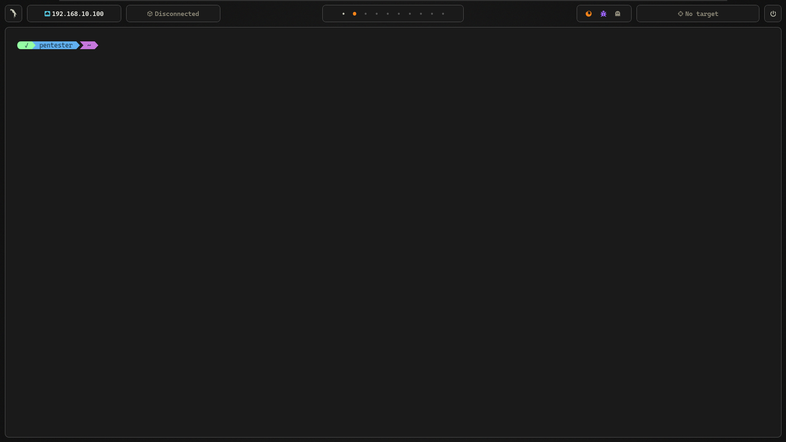

[English](README.md) | **Español**

<p align="center">
  <picture>
    <source media="(prefers-color-scheme: dark)" srcset="assets/dotfiles-parrot-lockup-white.svg">
    
  </picture>
</p>

<p align="center">
  Entorno de trabajo para pentesting sobre Parrot OS en un comando.<br>
  bspwm, polybar, kitty, zsh con oh-my-posh y Neovim, con hardening del sistema, una capa global
  de Claude Code y descargas verificadas.
</p>

<p align="center">
  <a href="#reproducir-en-un-comando">Instalar</a> ·
  <a href="#estructura-del-repo">Estructura</a> ·
  <a href="#atajos">Atajos</a> ·
  <a href="docs/README.es.md">Documentación</a> ·
  <a href="CONTRIBUTING.es.md">Contribuir</a>
</p>

<p align="center">
  <a href="https://github.com/M1gu3l4ngel/dotfiles-parrot/actions/workflows/ci.yml"></a>
  
  
  
  <a href="LICENSE"></a>
</p>

---



## Reproducir en un comando

¿Empiezas desde cero, sin VM? Sigue [docs/getting-started.es.md](docs/getting-started.es.md):
crear la VM, instalar Parrot, el entorno, comprobarlo y la snapshot.

En un Parrot OS 7 recién instalado, como usuario normal (pedirá la contraseña
de sudo una vez):

```bash
git clone https://github.com/M1gu3l4ngel/dotfiles-parrot.git ~/dotfiles
```

```bash
cd ~/dotfiles
```

```bash
./bootstrap.sh
```

Después, reinicia y en la pantalla de login elige la sesión `bspwm`.

## Requisitos previos

- Parrot OS 7 (basado en Debian 13). `anonsurf` solo existe en Parrot.
- Usuario con permisos de sudo y conexión a internet.
- Sesión X11: bspwm no funciona en Wayland.
- En VMware: "Accelerate 3D graphics" activado y 2 GB o más de memoria de
  vídeo. Ver [docs/vmware.es.md](docs/vmware.es.md).

## Qué hace bootstrap.sh

Cada paso comprueba si ya está hecho, así que se puede ejecutar varias veces
sin efectos colaterales (por ejemplo, tras un fallo de red).
`./bootstrap.sh --dry-run` muestra qué haría cada paso, sin sudo, descargas ni
cambios.

| Paso | Qué instala o configura |
|---|---|
| 1 | Paquetes de apt de `60-apps/apt.txt`: entorno gráfico, herramientas de terminal, seguridad, openvpn, VSCodium |
| 2 | Fuentes Nerd Fonts (CaskaydiaCove y Hack) en `~/.local/share/fonts/` |
| 3 | Neovim oficial en `/opt`, enlazado en `/usr/local/bin/nvim` |
| 4 | oh-my-posh (prompt) en `~/.local/bin/` |
| 5 | nvm, Node 24, pnpm y Claude Code |
| 6 | Clona [dotfiles-windows](https://github.com/M1gu3l4ngel/dotfiles-windows) en `~/dotfiles-windows`, de donde sale la capa de Claude Code |
| 7 | Enlaces de las configuraciones en `~/.config/` y `~/.claude/` y fusión de `~/.claude/settings.json` (`install.sh`) |
| 8 | Extensiones de VSCodium desde Open VSX (`30-editor/vscodium/extensions.txt`) |
| 9 | Hardening del sistema (`70-system/setup.sh`): firewall, sudoers, parches automáticos, pantalla de login |
| 10 | zsh como shell por defecto |
| 11 | Muestra los pasos manuales pendientes |

Todo lo que no viene de apt se descarga en una versión fijada y se verifica
con SHA-256 antes de instalarse.

## Pasos manuales tras la instalación

Implican secretos, así que no se automatizan:

1. Claves SSH y GPG, firma de commits y `pass`:
   [docs/keys-and-secrets.es.md](docs/keys-and-secrets.es.md).
2. Perfil de Firefox para pentesting: [docs/firefox.es.md](docs/firefox.es.md).

## Instalar sobre una configuración existente

Si ya tienes el entorno instalado y solo quieres estas configuraciones, desde
`~/dotfiles`:

```bash
./install.sh
```

Para ver antes qué cambiaría, sin tocar nada, ejecútalo con `--dry-run`. Con
`--check` lista el estado de cada enlace (`ok`, `MISSING` si falta, `STALE` si
apunta a una ruta vieja del repo, `FOREIGN` si es un archivo ajeno al repo) y de
`~/.claude/settings.json`, y sale con 1 si algo no está bien.

`install.sh` activa además el hook `githooks/post-merge` (`core.hooksPath`):
tras cada `git pull` que trae cambios vuelve a ejecutar `install.sh`, así una
configuración nueva o movida queda enlazada sin ejecutarlo a mano.

Antes de crear cada enlace, `install.sh` renombra lo que haya en el destino
(archivo, carpeta o enlace propio) con el sufijo `.pre-dotfiles.bak`; si
después falla el enlace, el original vuelve a su sitio. Un enlace a una ruta
vieja del repo (una carpeta movida) se rehace sin copia. Para volver atrás, ver
[Desinstalar](#desinstalar).

## Desinstalar

`uninstall.sh` revierte `install.sh`: quita los enlaces que apuntan a este
repo y devuelve a su sitio las copias `.pre-dotfiles.bak` de tus archivos
originales. Como usuario normal, desde `~/dotfiles`:

1. Ver qué haría, sin tocar nada:

    ```bash
    ./uninstall.sh --dry-run
    ```

2. Aplicarlo:

    ```bash
    ./uninstall.sh
    ```

3. Cerrar sesión y volver a entrar para usar la configuración original.

Solo quita enlaces de este repo: si en un destino hay un archivo tuyo, lo deja
y avisa. No desinstala paquetes ni revierte el hardening de `70-system/setup.sh`,
ni los ajustes que `install.sh` aplica sin enlaces (modo oscuro de GTK4,
Nautilus como gestor de carpetas e indexador desactivado). Las copias con
fecha (`.pre-dotfiles.bak.<fecha>`), de reinstalaciones, no se restauran: el
script las lista para que elijas a mano.

La lista de enlaces vive en `lib/links.sh` y la comparten los dos scripts:
para añadir una configuración nueva basta con sumar una línea allí. Los
enlaces de Claude Code no están en ella: salen de `50-claude/links.json` del
clon de [dotfiles-windows](https://github.com/M1gu3l4ngel/dotfiles-windows) en
`~/dotfiles-windows`.

## Estructura del repo

Las configuraciones se agrupan en capas numeradas, en el mismo orden que
[dotfiles-windows](https://github.com/M1gu3l4ngel/dotfiles-windows); dentro de
cada una, cada componente mantiene su estructura `<componente>/.config/<componente>/`.

| Directorio | Contenido | Se instala en |
|---|---|---|
| `10-shell/zsh/` | Shell | `~/.zshrc` |
| `10-shell/oh-my-posh/` | Tema del prompt, idéntico al de Windows | Se lee desde el repo |
| `15-git/gitconfig` | Identidad de git y firma de commits; la clave va en `~/.gitconfig.local` | `~/.gitconfig` |
| `15-git/gnupg/` | Configuración del agente GPG | `~/.gnupg/gpg-agent.conf` |
| `20-terminal/kitty/` | Terminal | `~/.config/kitty/` |
| `25-desktop/bspwm/` | Gestor de ventanas y script de redimensionado | `~/.config/bspwm/` |
| `25-desktop/sxhkd/` | Atajos de teclado | `~/.config/sxhkd/` |
| `25-desktop/polybar/` | Barras, paleta de colores y lanzador | `~/.config/polybar/` |
| `25-desktop/picom/` | Compositor (esquinas, transparencias) | `~/.config/picom/` |
| `25-desktop/rofi/` | Lanzador de aplicaciones y temas | `~/.config/rofi/` |
| `25-desktop/dunst/` | Notificaciones | `~/.config/dunst/` |
| `25-desktop/gtk/` | Colores y ajustes del gestor de archivos (GTK4) | `~/.config/gtk-4.0/` |
| `25-desktop/xkb/` | Distribución de teclado (us y latam) | `~/.config/xkb/` |
| `25-desktop/scripts/` | Módulos de polybar, target y anonimato | `~/.config/scripts/` |
| `30-editor/nvim/` | Neovim (NvChad) | `~/.config/nvim/` |
| `30-editor/vscodium/` | Ajustes, atajos y extensiones del editor VSCodium | `~/.config/Visual Studio Code/User/` |
| `40-format/` | Estilo por defecto de Prettier y EditorConfig para proyectos, idéntico al de Windows | `~/.prettierrc.json`, `~/.editorconfig` |
| `60-apps/` | Lista de paquetes de apt que instala `bootstrap.sh` | No se instala (la lee `bootstrap.sh`) |
| `70-system/` | Hardening, sudoers, Firefox, apt | `/etc`, `/usr/local/sbin` (copias) |
| `assets/` | Captura del escritorio y fondo por defecto | `~/.config/wallpaper.jpg` (el fondo) |
| `docs/` | Guías detalladas | No se instala |
| `githooks/` | `post-merge`: ejecuta `install.sh` tras cada `git pull` con cambios | `core.hooksPath` del clon |
| `lib/` | Lista de enlaces compartida por `install.sh` y `uninstall.sh` | No se instala |
| `tools/` | Comprobaciones del repo (`check.sh`) | No se instala |

## Atajos

### Sistema y aplicaciones

| Atajo | Acción |
|---|---|
| `Super+Enter` | Terminal (kitty) |
| `Super+D` | Lanzador de aplicaciones (rofi) |
| `Super+E` | Gestor de archivos (Nautilus); también con click en el logo de Parrot |
| `Super+Shift+F` | Firefox personal |
| `Super+Shift+P` | Firefox pentest |
| `Super+A` | Activar o desactivar el anonimato con Tor |
| `Super+Shift+X` | Bloquear la pantalla |
| `Super+Escape` | Recargar los atajos |
| `Super+Alt+R` | Recargar bspwm (y polybar) |
| `Super+Alt+Q` | Cerrar la sesión |
| Botón de apagado (polybar, esquina derecha) | Menú: apagar, reiniciar o cerrar sesión de forma ordenada |
| `Alt+Shift` | Cambiar la distribución de teclado (us / latam) |

### Ventanas

| Atajo | Acción |
|---|---|
| `Super+Q` | Cerrar la ventana |
| `Super+Shift+Q` | Forzar el cierre de la ventana |
| `Super+Flechas` | Mover el foco |
| `Super+Shift+Flechas` | Intercambiar con la ventana vecina |
| `Super+Alt+Flechas` | Redimensionar |
| `Super+Ctrl+Flechas` | Mover una ventana flotante |
| `Super+T` / `Super+S` / `Super+F` | Modo mosaico / flotante / pantalla completa |
| `Super+M` | Alternar entre mosaico y una sola ventana |
| `Super+G` | Intercambiar con la ventana más grande |

### Escritorios

| Atajo | Acción |
|---|---|
| `Super+1` ... `Super+0` | Ir al escritorio 1 a 10 |
| `Super+Shift+1` ... `Super+Shift+0` | Enviar la ventana a ese escritorio |
| `Super+[` / `Super+]` | Escritorio anterior / siguiente |
| `Super+Tab` | Último escritorio visitado |

### Terminal (kitty y zsh)

| Atajo | Acción |
|---|---|
| `Ctrl+Shift+Enter` | Nueva ventana de kitty en el mismo directorio |
| `Ctrl+Shift+T` | Nueva pestaña en el mismo directorio |
| `Ctrl+Tab` | Cambiar de pestaña |
| `Ctrl+Flechas` | Mover el foco entre ventanas de kitty |
| `Ctrl+Shift+V` | Pegar |
| `Shift+Flechas` / `Ctrl+Shift+Flechas` | Seleccionar texto por carácter / por palabra |
| `Ctrl+U` | Borrar la línea |
| `Ctrl+R` / `Ctrl+T` | Buscar en el historial / buscar archivos (fzf) |
| `Esc` `Esc` | Añadir o quitar `sudo` al comando |

Para el flujo de pentesting (VPN, target, qué IP usar) ver
[docs/pentesting.es.md](docs/pentesting.es.md).

## Solución de problemas

| Síntoma | Causa | Solución |
|---|---|---|
| Pantalla negra o bspwm no arranca al iniciar sesión | Sesión Wayland | Elegir la sesión `bspwm` en el login |
| El escritorio va lento al cambiar de workspace | VM sin aceleración 3D | Activarla en VMware ([docs/vmware.es.md](docs/vmware.es.md)) |
| `glxinfo` dice `Accelerated: no` | Falso positivo del driver de VMware | Mirar el renderer: `SVGA3D` es correcto |
| Iconos como cuadrados | Faltan las fuentes Nerd Font | Volver a ejecutar `./bootstrap.sh` |
| Un cambio en `.zshrc` no se aplica | Cada terminal conserva lo que cargó al abrirse | `exec zsh` en esa terminal |
| keychain pide la passphrase en cada terminal | La clave SSH no se llama `id_ed25519` | Ajustar el nombre en la línea de keychain de `10-shell/zsh/.zshrc` |
| El anonimato falla con "Tor no arrancó" | Falta la regla sudoers | `sudo ./70-system/setup.sh` desde `~/dotfiles` |
| Las notificaciones salen arriba y en azul | dunst arrancó antes de existir su configuración | `dunstctl reload` |
| polybar consume mucha CPU | Un módulo con `interval = 0` | Usar un intervalo mayor que 0 |

Para restaurar la configuración anterior a los dotfiles, ver
[Desinstalar](#desinstalar).

## Documentación

Guías detalladas en [docs/](docs/README.es.md): pentesting, anonimato, Firefox,
claves y secretos, VMware y personalización.

Para contribuir o modificar el repo: [CONTRIBUTING.es.md](CONTRIBUTING.es.md).

## Créditos y licencia

El prompt y la paleta de colores son compartidos con
[dotfiles-windows](https://github.com/M1gu3l4ngel/dotfiles-windows).

Licencia [MIT](LICENSE).
