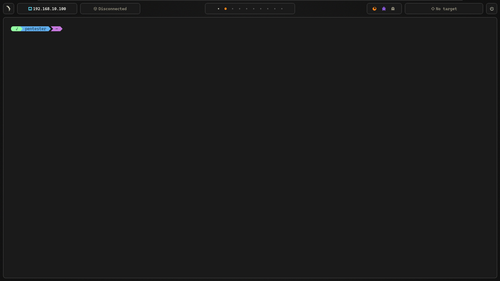

**English** | [Español](README.es.md)

<p align="center">
  <picture>
    <source media="(prefers-color-scheme: dark)" srcset="assets/dotfiles-parrot-lockup-white.svg">
    
  </picture>
</p>

<p align="center">
  A pentesting workstation on Parrot OS in one command.<br>
  bspwm, polybar, kitty, zsh with oh-my-posh and Neovim, with system hardening, a global Claude
  Code layer and verified downloads.
</p>

<p align="center">
  <a href="#one-command-setup">Install</a> ·
  <a href="#repository-layout">Structure</a> ·
  <a href="#shortcuts">Shortcuts</a> ·
  <a href="docs/README.md">Documentation</a> ·
  <a href="CONTRIBUTING.md">Contributing</a>
</p>

<p align="center">
  <a href="https://github.com/M1gu3l4ngel/dotfiles-parrot/actions/workflows/ci.yml"></a>
  
  
  
  <a href="LICENSE"></a>
</p>

---



## One-command setup

Starting from scratch, with no VM yet? Follow
[docs/getting-started.md](docs/getting-started.md): create the VM, install
Parrot, set up the environment, check it and take a snapshot.

On a fresh Parrot OS 7 install, as a regular user (it asks for the sudo
password once):

```bash
git clone https://github.com/M1gu3l4ngel/dotfiles-parrot.git ~/dotfiles
```

```bash
cd ~/dotfiles
```

```bash
./bootstrap.sh
```

Then reboot and pick the `bspwm` session on the login screen.

## Requirements

- Parrot OS 7 (based on Debian 13). `anonsurf` only exists on Parrot.
- A user with sudo rights and an internet connection.
- An X11 session: bspwm does not run on Wayland.
- On VMware: "Accelerate 3D graphics" enabled and 2 GB or more of graphics
  memory. See [docs/vmware.md](docs/vmware.md).

## What bootstrap.sh does

Every step checks whether it is already done, so it can be run again safely
(for example, after a network failure). `./bootstrap.sh --dry-run` shows what
each step would do, without sudo, downloads or changes.

| Step | What it installs or configures |
|---|---|
| 1 | apt packages from `60-apps/apt.txt`: desktop, terminal tools, security, openvpn, VSCodium |
| 2 | Nerd Fonts (CaskaydiaCove and Hack) in `~/.local/share/fonts/` |
| 3 | Official Neovim in `/opt`, linked as `/usr/local/bin/nvim` |
| 4 | oh-my-posh (prompt) in `~/.local/bin/` |
| 5 | nvm, Node 24, pnpm and Claude Code |
| 6 | Clones [dotfiles-windows](https://github.com/M1gu3l4ngel/dotfiles-windows) in `~/dotfiles-windows`, the source of the Claude Code layer |
| 7 | Config symlinks in `~/.config/` and `~/.claude/` and the merge of `~/.claude/settings.json` (`install.sh`) |
| 8 | VSCodium extensions from Open VSX (`30-editor/vscodium/extensions.txt`) |
| 9 | System hardening (`70-system/setup.sh`): firewall, sudoers, automatic patches, login screen |
| 10 | zsh as the default shell |
| 11 | Prints the remaining manual steps |

Everything that does not come from apt is downloaded at a pinned version and
verified against a SHA-256 hash before it is installed.

## Manual steps after installing

They involve secrets, so they are not automated:

1. SSH and GPG keys, commit signing and `pass`:
   [docs/keys-and-secrets.md](docs/keys-and-secrets.md).
2. Firefox profile for pentesting: [docs/firefox.md](docs/firefox.md).

## Install on top of an existing setup

If the environment is already installed and you only want these configs, from
`~/dotfiles`:

```bash
./install.sh
```

To see first what it would change, without changing anything, run it with
`--dry-run`. With `--check` it lists the state of every link (`ok`, `MISSING`,
`STALE` for an old repo path, `FOREIGN` for a file not from the repo) and of
`~/.claude/settings.json`, and exits with 1 if something is not right.

`install.sh` also turns on the `githooks/post-merge` hook (`core.hooksPath`):
after each `git pull` that brings changes, it runs `install.sh` again, so a
new or moved config is linked without running it by hand.

Before creating each link, `install.sh` renames whatever is at the target
(file, folder or your own symlink) with the `.pre-dotfiles.bak` suffix; if the
link then fails, the original goes back. A link to an old path inside the repo
(a moved folder) is replaced without a backup. To go back, see
[Uninstall](#uninstall).

## Uninstall

`uninstall.sh` reverts `install.sh`: it removes the links that point to this
repo and puts your original files back from their `.pre-dotfiles.bak` copies.
As a regular user, from `~/dotfiles`:

1. See what it would do, without changing anything:

    ```bash
    ./uninstall.sh --dry-run
    ```

2. Apply it:

    ```bash
    ./uninstall.sh
    ```

3. Log out and back in to use the original configuration.

It only removes links from this repo: if a target holds a file of yours, it
leaves it and warns. It does not uninstall packages or revert the
`70-system/setup.sh` hardening, nor the settings `install.sh` applies without
links (GTK4 dark mode, Nautilus as the folder handler, file indexer disabled).
Dated copies (`.pre-dotfiles.bak.<date>`), from reinstalls, are not restored:
the script lists them so you can choose by hand.

The list of links lives in `lib/links.sh` and both scripts share it: to add a
new config, add one line there. The Claude Code links are not listed there:
they come from `50-claude/links.json` of the
[dotfiles-windows](https://github.com/M1gu3l4ngel/dotfiles-windows) clone in
`~/dotfiles-windows`.

## Repository layout

The configs are grouped in numbered layers, in the same order as
[dotfiles-windows](https://github.com/M1gu3l4ngel/dotfiles-windows); inside
each one, every component keeps its `<component>/.config/<component>/` layout.

| Directory | Contents | Installed to |
|---|---|---|
| `10-shell/zsh/` | Shell | `~/.zshrc` |
| `10-shell/oh-my-posh/` | Prompt theme, identical to Windows | Read from the repo |
| `15-git/gitconfig` | git identity and commit signing; the key goes in `~/.gitconfig.local` | `~/.gitconfig` |
| `15-git/gnupg/` | GPG agent configuration | `~/.gnupg/gpg-agent.conf` |
| `20-terminal/kitty/` | Terminal | `~/.config/kitty/` |
| `25-desktop/bspwm/` | Window manager and resize script | `~/.config/bspwm/` |
| `25-desktop/sxhkd/` | Keyboard shortcuts | `~/.config/sxhkd/` |
| `25-desktop/polybar/` | Bars, color palette and launcher | `~/.config/polybar/` |
| `25-desktop/picom/` | Compositor (corners, transparency) | `~/.config/picom/` |
| `25-desktop/rofi/` | Application launcher and themes | `~/.config/rofi/` |
| `25-desktop/dunst/` | Notifications | `~/.config/dunst/` |
| `25-desktop/gtk/` | File manager colors and settings (GTK4) | `~/.config/gtk-4.0/` |
| `25-desktop/xkb/` | Keyboard layout (us and latam) | `~/.config/xkb/` |
| `25-desktop/scripts/` | polybar modules, target and anonymity | `~/.config/scripts/` |
| `30-editor/nvim/` | Neovim (NvChad) | `~/.config/nvim/` |
| `30-editor/vscodium/` | VSCodium settings, shortcuts and extensions | `~/.config/Visual Studio Code/User/` |
| `40-format/` | Default Prettier and EditorConfig style for projects, identical to Windows | `~/.prettierrc.json`, `~/.editorconfig` |
| `60-apps/` | apt package list that `bootstrap.sh` installs | Not installed (read by `bootstrap.sh`) |
| `70-system/` | Hardening, sudoers, Firefox, apt | `/etc`, `/usr/local/sbin` (copies) |
| `assets/` | Desktop screenshot and default wallpaper | `~/.config/wallpaper.jpg` (the wallpaper) |
| `docs/` | Detailed guides | Not installed |
| `githooks/` | `post-merge`: runs `install.sh` after each `git pull` with changes | `core.hooksPath` of the clone |
| `lib/` | Link list shared by `install.sh` and `uninstall.sh` | Not installed |
| `tools/` | Repo checks (`check.sh`) | Not installed |

## Shortcuts

### System and applications

| Shortcut | Action |
|---|---|
| `Super+Enter` | Terminal (kitty) |
| `Super+D` | Application launcher (rofi) |
| `Super+E` | File manager (Nautilus); also by clicking the Parrot logo |
| `Super+Shift+F` | Personal Firefox |
| `Super+Shift+P` | Pentest Firefox |
| `Super+A` | Toggle anonymity through Tor |
| `Super+Shift+X` | Lock the screen |
| `Super+Escape` | Reload shortcuts |
| `Super+Alt+R` | Reload bspwm (and polybar) |
| `Super+Alt+Q` | Log out |
| Power button (polybar, right corner) | Menu: clean shutdown, reboot or log out |
| `Alt+Shift` | Switch keyboard layout (us / latam) |

### Windows

| Shortcut | Action |
|---|---|
| `Super+Q` | Close the window |
| `Super+Shift+Q` | Force-close the window |
| `Super+Arrows` | Move focus |
| `Super+Shift+Arrows` | Swap with the neighboring window |
| `Super+Alt+Arrows` | Resize |
| `Super+Ctrl+Arrows` | Move a floating window |
| `Super+T` / `Super+S` / `Super+F` | Tiled / floating / fullscreen |
| `Super+M` | Toggle between tiled and a single window |
| `Super+G` | Swap with the largest window |

### Desktops

| Shortcut | Action |
|---|---|
| `Super+1` ... `Super+0` | Go to desktop 1 to 10 |
| `Super+Shift+1` ... `Super+Shift+0` | Send the window to that desktop |
| `Super+[` / `Super+]` | Previous / next desktop |
| `Super+Tab` | Last visited desktop |

### Terminal (kitty and zsh)

| Shortcut | Action |
|---|---|
| `Ctrl+Shift+Enter` | New kitty window in the same directory |
| `Ctrl+Shift+T` | New tab in the same directory |
| `Ctrl+Tab` | Switch tab |
| `Ctrl+Arrows` | Move focus between kitty windows |
| `Ctrl+Shift+V` | Paste |
| `Shift+Arrows` / `Ctrl+Shift+Arrows` | Select text by character / by word |
| `Ctrl+U` | Clear the line |
| `Ctrl+R` / `Ctrl+T` | Search history / search files (fzf) |
| `Esc` `Esc` | Add or remove `sudo` on the command |

For the pentesting workflow (VPN, target, which IP to use) see
[docs/pentesting.md](docs/pentesting.md).

## Troubleshooting

| Symptom | Cause | Fix |
|---|---|---|
| Black screen or bspwm does not start on login | Wayland session | Pick the `bspwm` session at login |
| The desktop is slow when switching workspaces | VM without 3D acceleration | Enable it in VMware ([docs/vmware.md](docs/vmware.md)) |
| `glxinfo` says `Accelerated: no` | False positive from the VMware driver | Check the renderer: `SVGA3D` is correct |
| Icons show as squares | Nerd Fonts missing | Run `./bootstrap.sh` again |
| A `.zshrc` change does not apply | Each terminal keeps what it loaded at startup | `exec zsh` in that terminal |
| keychain asks for the passphrase in every terminal | The SSH key is not named `id_ed25519` | Change the name in the keychain line of `10-shell/zsh/.zshrc` |
| Anonymity fails with "Tor no arrancó" | The sudoers rule is missing | `sudo ./70-system/setup.sh` from `~/dotfiles` |
| Notifications appear at the top and in blue | dunst started before its config existed | `dunstctl reload` |
| polybar uses a lot of CPU | A module with `interval = 0` | Use an interval greater than 0 |

To restore the configuration you had before these dotfiles, see
[Uninstall](#uninstall).

## Documentation

Detailed guides in [docs/](docs/README.md): pentesting, anonymity,
Firefox, keys and secrets, VMware and customization.

To contribute or change the repo: [CONTRIBUTING.md](CONTRIBUTING.md).

## Credits and license

The prompt and the color palette are shared with
[dotfiles-windows](https://github.com/M1gu3l4ngel/dotfiles-windows).

[MIT](LICENSE) license.
