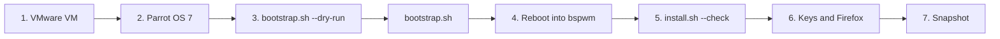

[English](getting-started.md) | **Español**

# Primeros pasos

De una VM vacía al escritorio terminado, en orden. Cada paso es corto y enlaza
a la guía con el detalle.



Sin VMware (Parrot instalado en una PC física o en otro hipervisor), sáltate
el paso 1 y la snapshot. `bootstrap.sh` y `70-system/setup.sh` lo detectan
solos: no instalan `open-vm-tools-desktop` y se saltan la carpeta compartida.
Las comprobaciones marcadas «solo VMware» tampoco aplican.

## 1. Crear la VM en VMware (Windows)

1. Recursos de la VM de referencia: 4 CPU, 8 GB de RAM y 60 GB de disco. La
   instalación completa ocupa unos 25 GB.
2. Con la VM apagada, en VM -> Settings -> Hardware -> Display: marca
   "Accelerate 3D graphics" y asigna 2 GB o más de "Graphics memory". Sin
   esto el escritorio va lento ([vmware.es.md](vmware.es.md)).
3. Red: un solo adaptador en NAT. No hace falta un segundo adaptador
   host-only: la carpeta compartida no usa la red.
4. Carpeta compartida, antes de instalar nada (así el paso 3 la deja
   montada):
    1. En Windows, crea una carpeta dedicada, por ejemplo `C:\VMShare`.
    2. En VM -> Settings -> Options -> Shared Folders: "Always enabled" ->
       Add, con esa carpeta y el nombre `VMShare`.

    Detalle y uso seguro en [vmware.es.md](vmware.es.md#carpeta-compartida-con-el-host).

## 2. Instalar Parrot OS

1. Instala Parrot Security 7 (la edición Security trae `anonsurf` y las
   herramientas de pentesting).
2. Crea tu usuario con permisos de sudo.
3. Inicia sesión y abre una terminal.

## 3. Instalar el entorno

Como usuario normal (el script pedirá la contraseña de sudo una vez).

1. Clonar el repo en `~/dotfiles`:

    ```bash
    git clone https://github.com/M1gu3l4ngel/dotfiles-parrot.git ~/dotfiles
    ```

2. Entrar en el repo:

    ```bash
    cd ~/dotfiles
    ```

3. Ver qué haría cada paso, sin sudo, descargas ni cambios. Cada línea dice
   qué instalaría o enlazaría, o que ya está hecho:

    ```bash
    ./bootstrap.sh --dry-run
    ```

4. Instalar todo:

    ```bash
    ./bootstrap.sh
    ```

Qué hace cada paso del script: [README](../README.es.md#qué-hace-bootstrapsh).
Si falla (por ejemplo, un corte de red), vuelve a ejecutarlo: solo aplica lo
que falta.

## 4. Reiniciar y entrar en bspwm

1. Reinicia (en cualquier directorio, como usuario normal):

    ```bash
    systemctl reboot
    ```

2. En la pantalla de login, elige la sesión `bspwm` antes de escribir la
   contraseña. bspwm no funciona en Wayland.

## 5. Comprobar que todo funciona

Como usuario normal salvo donde se indica.

1. Enlaces y ajustes de Claude Code, desde `~/dotfiles`. Debe terminar en
   `All installed`; si no, lista lo que está mal y sale con 1:

    ```bash
    ./install.sh --check
    ```

2. Aceleración gráfica, solo VMware. Debe mostrar `SVGA3D` (si muestra
   `llvmpipe`, revisa el paso 1.2):

    ```bash
    glxinfo -B | grep renderer
    ```

3. Firewall. Con sudo; debe indicar que está activo:

    ```bash
    sudo ufw status
    ```

4. Carpeta compartida, solo VMware. Debe listar el contenido de `C:\VMShare`:

    ```bash
    ls ~/VMShare
    ```

5. Escritorio: barras de polybar arriba, `Super+Enter` abre kitty, `Super+D`
   abre el menú de aplicaciones y `Super+Shift+X` bloquea la pantalla.

## 6. Pasos manuales

Implican secretos, así que no se automatizan:

1. Claves SSH y GPG, firma de commits y `pass`:
   [keys-and-secrets.es.md](keys-and-secrets.es.md).
2. Perfil de Firefox para pentesting: [firefox.es.md](firefox.es.md).

## 7. Snapshot

Guarda este estado limpio para poder volver a él si algo se rompe.

1. Apaga la VM (en cualquier directorio, como usuario normal):

    ```bash
    systemctl poweroff
    ```

2. En VMware: VM -> Snapshot -> Take Snapshot. Con la VM apagada la snapshot
   guarda solo el disco: ocupa menos y se restaura sin sorpresas.

## Siguiente

- Trabajar contra un lab: [pentesting.es.md](pentesting.es.md).
- Anonimato con Tor: [anonymity.es.md](anonymity.es.md).
- Cambiar el aspecto: [customization.es.md](customization.es.md).
