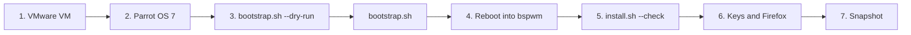

**English** | [Español](getting-started.es.md)

# Getting started

From an empty VM to the finished desktop, in order. Each step is short and
links to the guide with the details.



Without VMware (Parrot installed on a physical PC or in another hypervisor),
skip step 1 and the snapshot. `bootstrap.sh` and `70-system/setup.sh` detect
it on their own: they do not install `open-vm-tools-desktop` and skip the
shared folder. The checks marked "VMware only" do not apply either.

## 1. Create the VM in VMware (Windows)

1. Resources of the reference VM: 4 CPUs, 8 GB of RAM and a 60 GB disk. The
   full install takes about 25 GB.
2. With the VM powered off, in VM -> Settings -> Hardware -> Display: check
   "Accelerate 3D graphics" and assign 2 GB or more of "Graphics memory".
   Without this the desktop is slow ([vmware.md](vmware.md)).
3. Network: a single NAT adapter. No second host-only adapter is needed: the
   shared folder does not use the network.
4. Shared folder, before installing anything (so step 3 leaves it
   mounted):
    1. On Windows, create a dedicated folder, for example `C:\VMShare`.
    2. In VM -> Settings -> Options -> Shared Folders: "Always enabled" ->
       Add, with that folder and the name `VMShare`.

    Details and safe use in [vmware.md](vmware.md#shared-folder-with-the-host).

## 2. Install Parrot OS

1. Install Parrot Security 7 (the Security edition ships `anonsurf` and the
   pentesting tools).
2. Create your user with sudo rights.
3. Log in and open a terminal.

## 3. Install the environment

As a regular user (the script asks for the sudo password once).

1. Clone the repo into `~/dotfiles`:

    ```bash
    git clone https://github.com/M1gu3l4ngel/dotfiles-parrot.git ~/dotfiles
    ```

2. Enter the repo:

    ```bash
    cd ~/dotfiles
    ```

3. See what each step would do, without sudo, downloads or changes. Each
   line says what it would install or link, or that it is already done:

    ```bash
    ./bootstrap.sh --dry-run
    ```

4. Install everything:

    ```bash
    ./bootstrap.sh
    ```

What each step of the script does: [README](../README.md#what-bootstrapsh-does).
If it fails (for example, a network outage), run it again: it only applies
what is missing.

## 4. Reboot and log into bspwm

1. Reboot (from any directory, as a regular user):

    ```bash
    systemctl reboot
    ```

2. On the login screen, pick the `bspwm` session before typing your
   password. bspwm does not run on Wayland.

## 5. Check that everything works

As a regular user except where noted.

1. Links and Claude Code settings, from `~/dotfiles`. It must end with
   `All installed`; otherwise it lists what is wrong and exits with 1:

    ```bash
    ./install.sh --check
    ```

2. Graphics acceleration, VMware only. It must show `SVGA3D` (if it shows
   `llvmpipe`, review step 1.2):

    ```bash
    glxinfo -B | grep renderer
    ```

3. Firewall. With sudo; it must report that it is active:

    ```bash
    sudo ufw status
    ```

4. Shared folder, VMware only. It must list the contents of `C:\VMShare`:

    ```bash
    ls ~/VMShare
    ```

5. Desktop: polybar bars at the top, `Super+Enter` opens kitty, `Super+D`
   opens the application menu and `Super+Shift+X` locks the screen.

## 6. Manual steps

They involve secrets, so they are not automated:

1. SSH and GPG keys, commit signing and `pass`:
   [keys-and-secrets.md](keys-and-secrets.md).
2. Firefox profile for pentesting: [firefox.md](firefox.md).

## 7. Snapshot

Save this clean state so you can go back to it if something breaks.

1. Power off the VM (from any directory, as a regular user):

    ```bash
    systemctl poweroff
    ```

2. In VMware: VM -> Snapshot -> Take Snapshot. With the VM powered off the
   snapshot only stores the disk: it takes less space and restores without
   surprises.

## Next

- Work against a lab: [pentesting.md](pentesting.md).
- Anonymity through Tor: [anonymity.md](anonymity.md).
- Change the look: [customization.md](customization.md).
